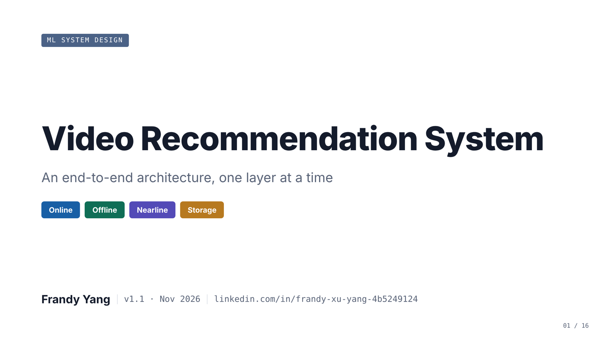
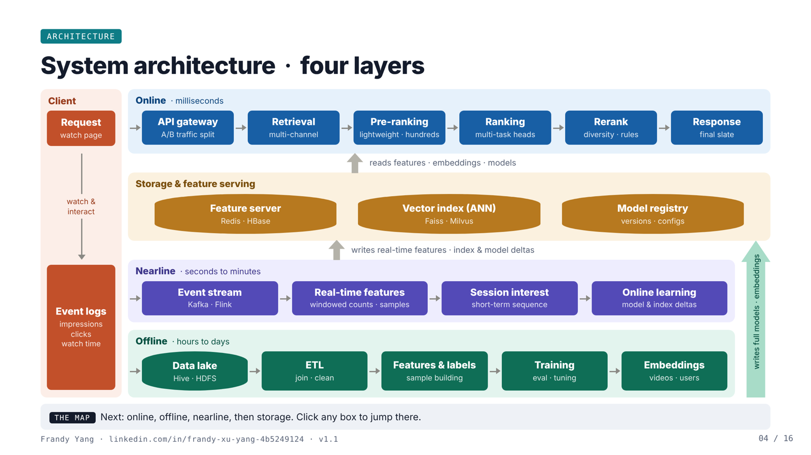

# Video Recommendation System Design

An end-to-end architecture for a YouTube-style "Up Next" recommender, walked through one layer at a time.

**[▶ View the slides in your browser](https://frandyruc.github.io/recsys-system-design/)** · **[Download PDF (16 pages)](Video_Recommendation_System_Design_v1.1.pdf)**

Use ← → or the arrow buttons to move between slides; click any box on the agenda or architecture map to jump to that section.

## What this is

I put this deck together for an ML system design study group. It takes the classic "design a video recommendation system" question and organizes the answer around a four-layer architecture map. Each layer then gets its own deep dive, with a focus on how these systems actually behave in production.

It's useful if you're:

- preparing for ML system design interviews
- moving from model work into the system side of recommendation
- looking for a single map that ties retrieval, ranking, features, training and experiments together

## The map

| Layer | Timescale | What it does |
|---|---|---|
| **Online** | milliseconds | Serves each request: gateway, retrieval, pre-ranking, ranking, rerank. Reads only. |
| **Offline** | hours to days | Builds the data, features and models. |
| **Nearline** | seconds to minutes | Keeps features, and then models, fresh. |
| **Storage** | — | The contract between layers: feature server, vector index, model registry. |

## Contents

| # | Slide |
|---|---|
| 1 | Video Recommendation System |
| 2 | What we'll cover |
| 3 | Problem & objective |
| 4 | System architecture · four layers |
| 5 | Online · the recommendation funnel |
| 6 | Retrieval · multi-channel |
| 7 | Pre-ranking · three designs, pick by budget |
| 8 | Ranking · multi-task model |
| 9 | Ranking · Prediction Server |
| 10 | Rerank · from scores to a list |
| 11 | Offline · the factory behind the feed |
| 12 | From logged feedback · to a validated model |
| 13 | Nearline · fresh features, then fresh models |
| 14 | Storage · the contract between layers |
| 15 | Multi-layer experiments · teams test in parallel |
| 16 | Wrap-up · four layers, one loop |

## Highlights

- **Multi-channel retrieval**: interest tags, two-tower ANN, collaborative filtering, trending and exploration, each with its own timeout.
- **Pre-ranking trade-offs**: two-tower, three-tower or COLD-style, chosen by latency budget.
- **Multi-task ranking**: shared-bottom, MMoE, PLE, and what a production prediction server looks like.
- **Rerank as a list problem**: diversity explained with a DPP, the geometric "maximize the volume" intuition.
- **Train/serve consistency**: one feature definition, versions switched together, caches in front.
- **Multi-layer A/B experiments**: domains, layers and orthogonal hashing, so many teams can test in parallel.

## References

- 飞叔杂谈, *Recommender System Architecture* series and *Recommender Engineering Practice*
- Hello Interview, ML System Design: *Video Recommendations*
- Tang et al., *Overlapping Experiment Infrastructure: More, Better, Faster Experimentation*, KDD 2010
- Yi et al., *Sampling-Bias-Corrected Neural Modeling for Large Corpus Item Recommendations*, RecSys 2019
- Wilhelm et al., *Practical Diversified Recommendations on YouTube with Determinantal Point Processes*, CIKM 2018
- Chen et al., *Fast Greedy MAP Inference for Determinantal Point Process to Improve Recommendation Diversity*, NeurIPS 2018
- Liu et al., *Monolith: Real Time Recommendation System With Collisionless Embedding Table*, 2022

## Versions

| Version | Date | Notes |
|---|---|---|
| v1.1 | Nov 2026 | Removed case figures and company names from slides 7 and 14 |
| v1.0 | Nov 2026 | First public version |

## Author

**Frandy Yang**, Senior Machine Learning Engineer, recommendation and ranking systems
[LinkedIn](https://www.linkedin.com/in/frandy-xu-yang-4b5249124/)

For consulting, team training or collaboration on machine learning, recommendation systems and AI applications, reach me at [frandyyang157@gmail.com](mailto:frandyyang157@gmail.com).

Feedback and corrections are welcome. Open an issue or reach out on LinkedIn.

## License

© 2026 Frandy Yang. Licensed under [CC BY-NC 4.0](https://creativecommons.org/licenses/by-nc/4.0/).

You're free to share and adapt this material with credit, but not for commercial use.
